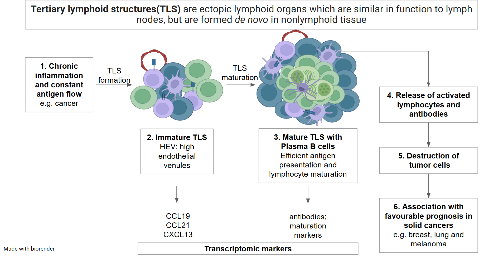
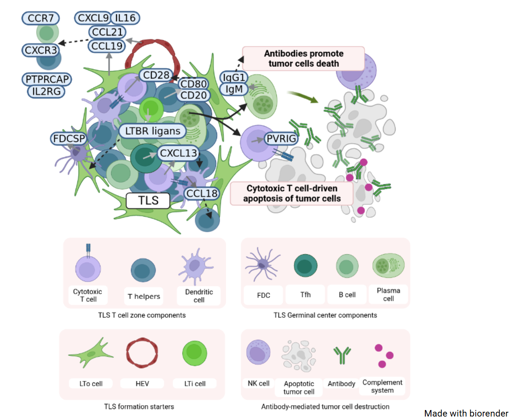
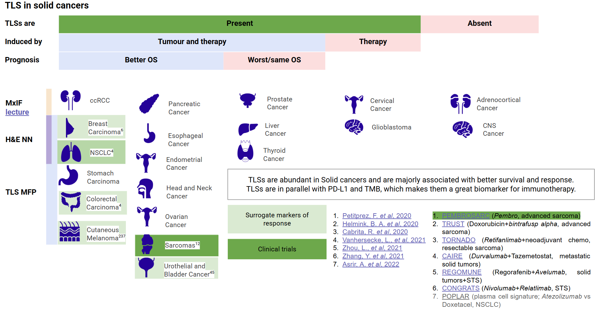
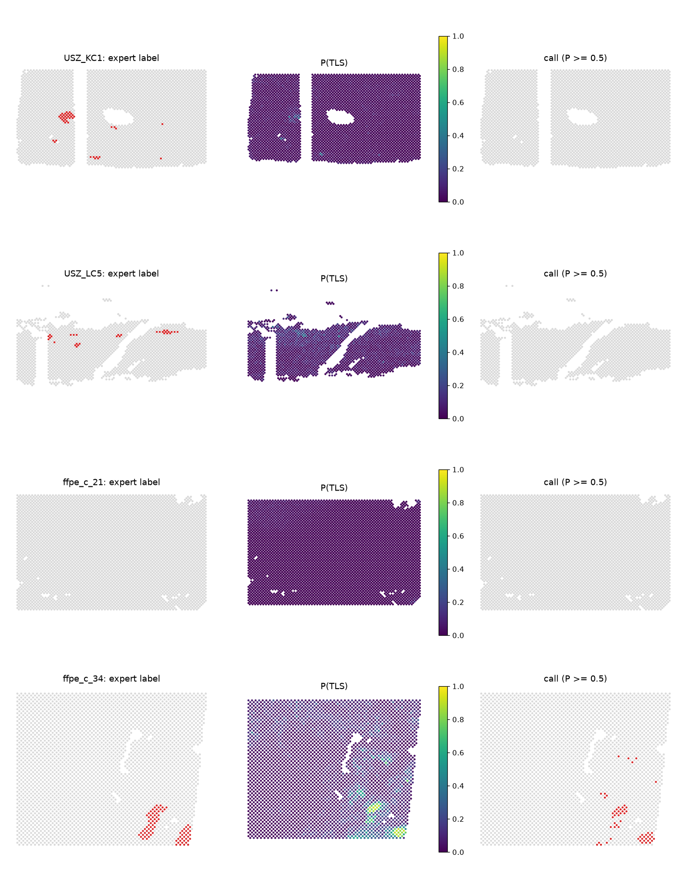
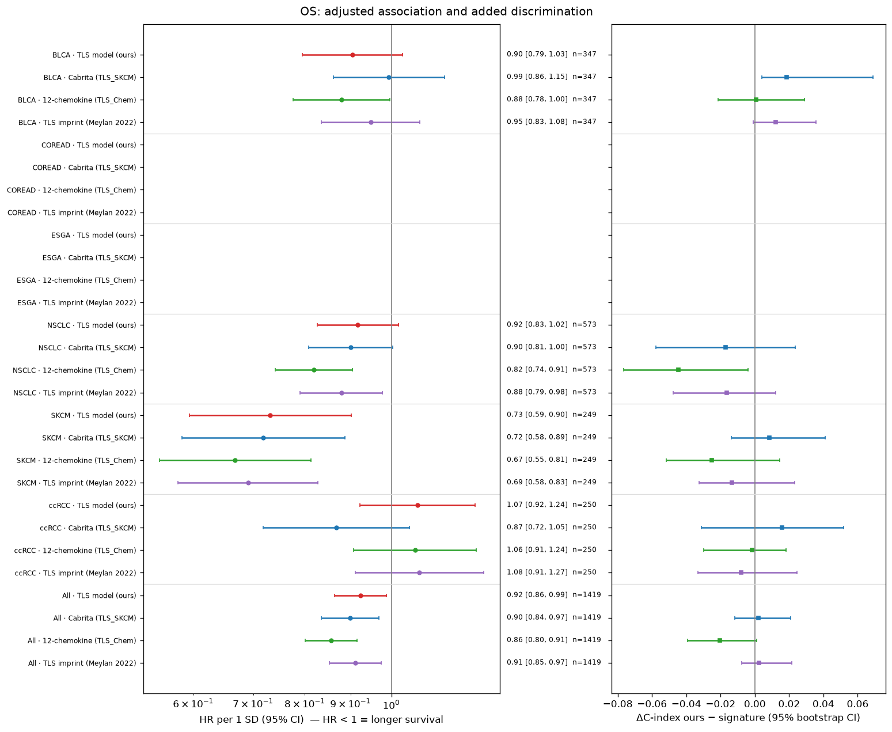
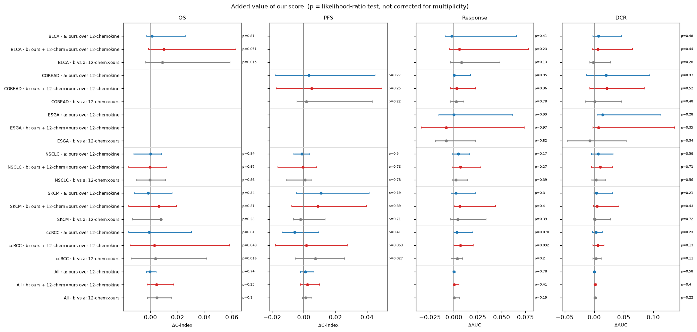

# tls-spatial-bulk

One expression-only model that reads **tertiary lymphoid structures (TLS)** from a **Visium spot** or a
**bulk RNA-seq sample**: *no TLS / TLS* plus a calibrated confidence, one sample at a time.

## Why

**What a TLS is.** An ectopic lymphoid organ that forms *de novo* inside chronically inflamed tissue, tumours
included: a B-cell follicle (mature TLS: with a germinal centre and follicular dendritic cells), a T-cell zone and
high endothelial venules. Inside the tumour it primes T cells and produces plasma cells and antibodies against
the tumour.





**Why it matters.** TLS are an immunotherapy biomarker that adds to the ones used today. In 540 tumours treated
with anti-PD-1 / PD-L1, mature TLS predicted objective response (43.1 % vs 19.6 %), PFS and OS **independently of
PD-L1 and CD8 density** (Vanhersecke et al., *Nat Cancer* 2021,
[doi:10.1038/s43018-021-00232-6](https://doi.org/10.1038/s43018-021-00232-6)); in a small subset (n = 70) the
mature-TLS rate did not differ by TMB.



**The gap.** TLS are scored on H&E / multiplex IF or with spatial transcriptomics: accurate, but slow and expensive.
Bulk RNA-seq is routine, yet bulk TLS signatures are imprecise: inside one cohort the published signatures reach
an AUROC of only ~0.6 against pathologist calls (this repo, CV).

**This project** trains one model on both worlds: spot-level TLS annotation from spatial transcriptomics *and*
pathologist TLS calls on bulk samples, on shared single-sample features, so the same model scores a spot or a
bulk sample.

## Key numbers

All values: 95 % bootstrap CI; test and OOD patients were never seen in training.

| evaluation | n (TLS+) | AUROC |
|---|---|---|
| Visium spots, held-out patients | 25,206 spots (374), 7 patients | **0.930 [0.886, 0.960]** |
| Bulk, held-out patients, all cohorts pooled | 162 (80) | 0.757 [0.679, 0.827] |
| Bulk, held-out patients, within one cohort | 17–45 per cohort | 0.45–0.70 (wide CIs) |
| OOD, Internal lung (local data, not in repo) | 47 (17) | **0.855 [0.742, 0.950]** |
| OOD, CPTAC-PAAD | 129 (54) | 0.641 [0.543, 0.738] |

Predicted P(TLS) on held-out Visium sections (patients never seen in training):



Interactive ROC curves per cohort (our model vs the published signatures) and a UMAP of the immunotherapy
samples: [online report](https://onion-42.github.io/tls-spatial-bulk/report.html).

**Immunotherapy cohorts** (2,689 ICI-treated patients, 6 cancer types; adjusted Cox / logistic models vs three
published TLS signatures, `results/ici/`): a higher TLS score goes with longer OS / PFS and more responses, but
the effect is small (pooled OS HR 0.92 per SD), and the model is **not better than the 12-chemokine signature** —
it adds nothing on top of it (likelihood-ratio tests ≈ null). An interaction of the two scores is a hypothesis
only (bladder IMvigor210 and ccRCC, not corrected for multiplicity).





**Limitations.** Spots work, bulk within one cohort is weak (~0.55–0.65 for every model family, signatures
included). Bulk probabilities over-call TLS on a new cohort — use the ranking there. No maturity output: the
maturity head showed no signal and was removed.

## Data and splits

| block | source | train | test | OOD |
|---|---|---|---|---|
| Visium, GSE175540 (ccRCC, FFPE + frozen; Meylan *Immunity* 2022) | GEO | 17 patients · 18 sections · 49,861 spots (2,023 TLS) | 5 · 5 · 19,499 (301) | – |
| Visium, USZ (kidney + lung FFPE; Zenodo 14620362, CC-BY-4.0) | Zenodo | 6 · 6 · 18,539 (852) | 2 · 2 · 5,707 (73) | – |
| TCGA-LUAD | TCGA | 406 (313) | 45 (32) | – |
| TCGA-BRCA | TCGA | 389 (185) | 31 (18) | – |
| TCGA-KIRC/KIRP/KICH | TCGA | 168 (18) | 42 (5) | – |
| TCGA-PAAD | TCGA | 94 (71) | 24 (18) | – |
| CPTAC-ccRCC | CPTAC | 69 (20) | 17 (5) | – |
| MGH LUAD (local, not in repo) | non-public | 9 (7) | 3 (2) | – |
| CPTAC-PAAD | CPTAC | – | – | 129 (54) |
| Internal lung (local, not in repo) | non-public | – | – | 47 (17) |

Bulk cells: samples (TLS+). Splits are by patient; test metrics use pathologist labels only (HookNet-TLS CNN labels are
train-only). Public bulk expression + labels are in `data/bulk/`; Visium is downloaded by notebook 01; non-public
cohorts and the immunotherapy cohorts live in `data/private/` (gitignored) — the pipeline runs without them.

## Install

```bash
uv sync                 # Python 3.12
uv run pytest -q        # unit tests incl. "no OOD / test patient in train" and repo hygiene
```

## Use

Run the notebooks top to bottom (`uv run jupyter lab`); every step is idempotent and all paths live in
`config.yaml`.

| notebook | does |
|---|---|
| `01_load_visium` | downloads GEO + Zenodo (~3 GB), one AnnData per section, QC, label maps |
| `02_load_bulk` | bulk cohorts + labels, label-agreement ceiling, builds the unit table |
| `03_train` | CV model selection, calibration, held-out test, SHAP → `models/tls_model.pkl` |
| `04_predict_ood` | OOD cohorts, once; spot maps on held-out sections |
| `05_ici_validation` | immunotherapy cohorts: response / DCR / OS / PFS vs baseline signatures, forest plots |

Score your own bulk samples (log2(TPM + 1), samples × HUGO genes) with the trained model:

```python
import json, pickle
import pandas as pd
from tls_model import io_ici

log_tpm = pd.read_csv("my_samples.tsv", sep="\t", index_col=0)          # samples × genes
meta = json.load(open("data/processed/meta.json"))
saved = pickle.load(open("models/tls_model.pkl", "rb"))
p_tls = io_ici.score_tls(log_tpm, meta, saved)                         # calibrated P(TLS) per sample
```

Methods, the course of the work, all figures, baselines and the survival analysis: **`report.html`**, online at
**https://onion-42.github.io/tls-spatial-bulk/report.html** (interactive ROC and UMAP need an internet connection for plotly.js). Rebuild it after notebook 05 with
`uv run python scripts/report_data.py` (per-sample inputs → `data/private/report/`, needs the local cohorts) and
`uv run python scripts/build_report.py`.

## Layout

```
src/tls_model/   io_visium · io_bulk · io_ici · labels · pseudobulk · features · splits · models · evaluate
                 prepare · pipeline · ici_stats · ici_report
notebooks/       01–05 (executed; no per-sample output of non-public cohorts)
scripts/         build_report.py · report_data.py (report.html)
tests/           pytest
results/         metric tables (tsv), results/ici/, figures
report.html      full report (aggregates + interactive ROC / UMAP; no sample ids)
```
