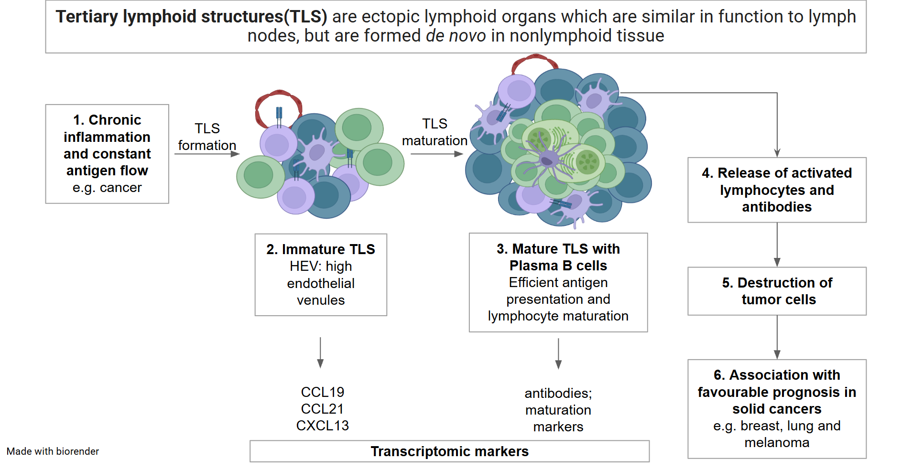
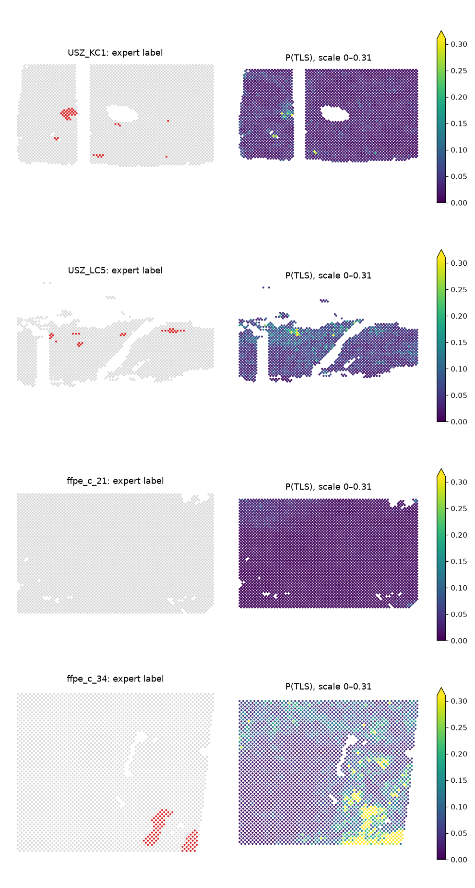
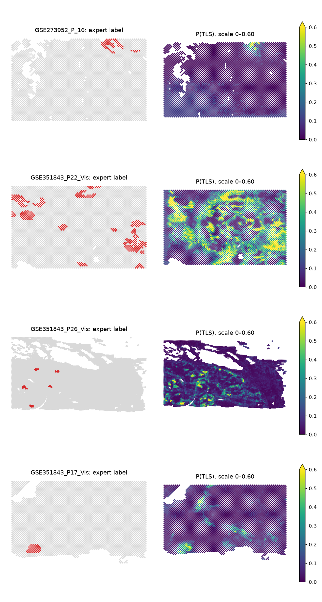
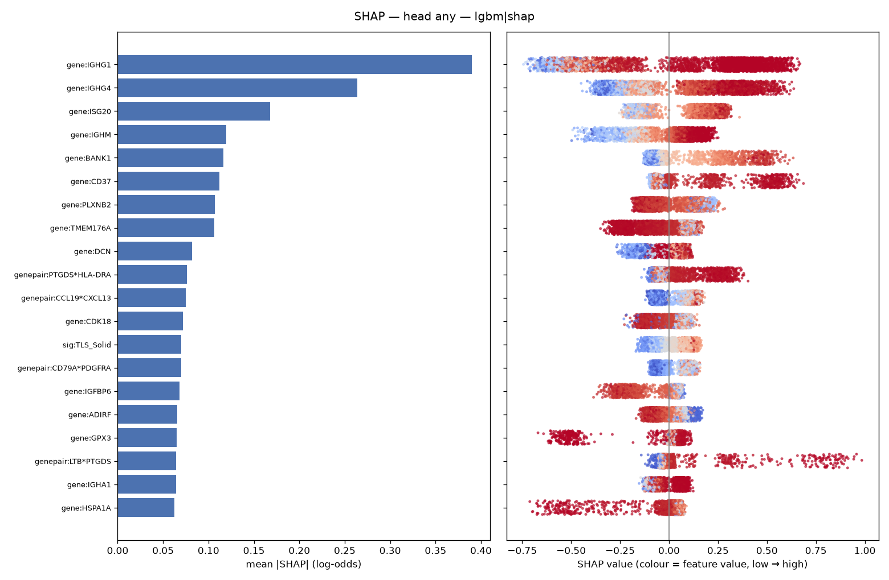

# tls-spatial-bulk

One expression-only model that reads **tertiary lymphoid structures (TLS)** from a **Visium spot** or a
**bulk RNA-seq sample**: *no TLS / immature TLS / mature TLS* class probabilities, one sample at a time.

## Why

**What a TLS is.** An ectopic lymphoid organ that forms *de novo* inside chronically inflamed tissue, tumours
included: a B-cell follicle (mature TLS: with a germinal centre and follicular dendritic cells), a T-cell zone and
high endothelial venules. Inside the tumour it primes T cells and produces plasma cells and antibodies against
the tumour.




**Why it matters.** TLS are an immunotherapy biomarker that adds to the ones used today. In 540 tumours treated
with anti-PD-1 / PD-L1, mature TLS predicted objective response (43.1 % vs 19.6 %), PFS and OS **independently of
PD-L1 and CD8 density** (Vanhersecke et al., *Nat Cancer* 2021,
[doi:10.1038/s43018-021-00232-6](https://doi.org/10.1038/s43018-021-00232-6)); in a small subset (n = 70) the
mature-TLS rate did not differ by TMB.


**The gap.** TLS are scored on H&E / multiplex IF or with spatial transcriptomics: accurate, but slow and expensive.
Bulk RNA-seq is routine, yet bulk TLS signatures are imprecise: inside one cohort the published signatures reach
an AUROC of only ~0.6 against pathologist calls (this repo, CV).

**This project** trains one model on spot-level TLS annotation from spatial transcriptomics (the gold labels),
carries it to bulk RNA-seq by self-distillation on TCGA (the teacher's own soft predictions, not the TCGA labels, train
the student), on shared single-sample features, so the same model scores a spot or a bulk sample. Pathologist TLS
calls on bulk samples are kept for testing: the TCGA test split in-distribution, CPTAC and new Visium cohorts as a true
holdout.

## Key numbers

All values: 95 % bootstrap CI; test and holdout patients were never seen in training. Model retrained 2026-11-10 on
public data only (no MGH, no Internal lung; the previous run had Internal lung at 0.855 [0.742, 0.950]).

| evaluation | n (TLS+) | AUROC |
|---|---|---|
| Visium spots, held-out patients (test) | 25,206 (374), 7 patients | **0.930 [0.890, 0.961]** |
| Bulk, TCGA test split, four cohorts pooled | 142 (73) | 0.747 [0.667, 0.824] |
| Bulk, TCGA test split, within one cohort | 24–45 per cohort | 0.57–0.69 (wide CIs) |
| Holdout Visium, GSE273952 (ccRCC FFPE, 8 new sections) | 38,227 spots (871), 8 patients | **0.934 [0.883, 0.952]** |
| Holdout Visium, GSE351843 (breast), lymphoid aggregates = TLS | 259,176 spots (4,698), 32 patients | **0.948 [0.926, 0.967]** |
| Holdout Visium, GSE351843, aggregates excluded (only H&E-called TLS positive) | 254,667 spots (189), 32 patients | 0.982 [0.969, 0.991] |
| Holdout pseudo-bulk: whole test + holdout Visium sections | 41 (32) | 0.868 [0.735, 0.967] |
| Holdout bulk, CPTAC-PAAD | 129 (54) | 0.673 [0.571, 0.762] |
| Holdout bulk, CPTAC-ccRCC | 86 (25) | 0.595 [0.467, 0.718] |
| Holdout bulk, TCGA-BLCA, HookNet-TLS manual label (any TLS polygon) | 303 (225) | 0.644 [0.572, 0.720] |
| Holdout bulk, TCGA-BLCA, strict label (germinal-centre polygon present) | 303 (114) | 0.624 [0.557, 0.689] |
| Holdout bulk, TCGA-LUSC, HookNet-TLS manual label | 342 (312) | 0.615 [0.514, 0.718] |
| Holdout bulk, TCGA-LUSC, strict label | 342 (98) | 0.571 [0.502, 0.634] |
| Holdout GeoMx ROIs, GSE271255 glioma: TLS vs control ROIs | 81 (61), 20 patients | **0.963 [0.922, 0.995]** |
| Holdout GeoMx AOIs, GSE276935 ovarian: CD20 follicle vs Immune / Stroma / Tumor segments | 289 (78), 11 patients | 0.781 [0.696, 0.880] |
| GSE276935, CD20 vs Immune only (immune cells without a follicle) | 172 (78) | 0.606 [0.488, 0.718] |
| GSE276935, CD20 vs Stroma + Tumor | 195 (78) | 0.921 [0.868, 0.979] |

Maturity (P(mature | TLS), among TLS-positive units with a known maturity) and the 3-class output (macro one-vs-rest
AUROC over no TLS / immature / mature; the AUROC of mature vs everything else in brackets):

| evaluation | n (mature) | P(mature \| TLS) AUROC | 3-class macro AUROC (mature vs rest) |
|---|---|---|---|
| Bulk, TCGA test split | 68 (10) | 0.607 [0.370, 0.812] | 0.700 (0.598) |
| Bulk, CPTAC-PAAD holdout | 54 (11) | 0.539 [0.299, 0.759] | 0.635 (0.567) |
| Bulk, TCGA-BLCA holdout (HookNet GC = mature) | 225 (114) | 0.618 [0.549, 0.688] | 0.591 (0.634) |
| Bulk, TCGA-LUSC holdout (HookNet GC = mature) | 312 (98) | 0.545 [0.474, 0.615] | 0.554 (0.569) |
| USZ test spots | 73 (17) | 0.413 [0.413, 0.601] | – |
| Holdout Visium spots, GSE273952 | 793 (65) | – | 0.941 (0.963) |
| Holdout Visium spots, GSE351843 | 4698 (189) | – | 0.956 (0.979) |
| Holdout Visium spots, both cohorts | 5,491 (254) | 0.670 [0.605, 0.812] | 0.948 (0.969) |
| Holdout pseudo-bulk sections | 32 (7) | – | 0.762 (0.828) |

Mature vs rest is high on spots because mature TLS are also the strongest TLS signal; **mature vs immature among TLS
is weak everywhere** (0.4–0.7, intervals crossing 0.5), and the argmax call never returns "mature" (P(mature) =
P(TLS) · P(mature | TLS) rarely exceeds the other two). Read the 3-class output as a ranking, not as a call. The two
HookNet cohorts are the first bulk maturity test with hundreds of germinal-centre calls: BLCA 0.62 [0.55, 0.69] is the
first bulk maturity interval that excludes 0.5, LUSC does not.

**HookNet-TLS holdout (TCGA-BLCA, TCGA-LUSC).** TLS+ = any TLS polygon on the diagnostic FFPE slide (more inclusive than
the archive LA1+ call: 44 % of the archive's KIRC pathologist negatives carry a HookNet TLS, κ 0.25 on 142 shared kidney
samples, `results/label_ceiling_kirc.tsv`), mature = a germinal-centre polygon; the RNA comes from a different frozen
piece. P(TLS) reaches 0.64 / 0.62 against the inclusive label and 0.62 / 0.57 against the GC-anchored strict label
(`results/ood_hooknet_strict.tsv`) — the same within-cohort band as CPTAC.

**GeoMx regions** (`results/ood_geomx.tsv`, raw model probability, bootstrap over patients): TLS vs control ROIs in
glioma separate almost perfectly (0.96), CD20 follicle segments vs stroma / tumour segments in ovarian cancer too
(0.92), but CD20 vs immune segments without a follicle only 0.61 [0.49, 0.72] (0.77 on the 48 AOIs without an author
QC flag): the model reads lymphocyte content well and the follicle itself weakly, which is the same limit the
maturity head shows.

**Reference points** (`results/baselines.tsv`, `scripts/score_baselines.py`): the same blocks and bootstrap for a dummy
(one constant per unit kind = the gold training prevalence; AUROC 0.5 by construction) and the three published TLS
signatures scored by ssGSEA on the model's gene panel (rankings, no calibration). AUROC [95 % CI]:

| evaluation | ours | best signature | 12-chemokine | Cabrita | TLS imprint |
|---|---|---|---|---|---|
| Visium spots, test | **0.930 [0.890, 0.961]** | TLS imprint 0.828 | 0.789 | 0.755 | 0.828 |
| Visium spots, holdout (both cohorts) | **0.940 [0.922, 0.956]** | Cabrita 0.878 | 0.849 | 0.878 | 0.841 |
| Pseudo-bulk sections, holdout | 0.868 [0.735, 0.967] | 12-chemokine 0.934 | 0.934 | 0.872 | 0.906 |
| Bulk, TCGA test split pooled | 0.747 [0.667, 0.824] | TLS imprint 0.729 | 0.596 | 0.387 | 0.729 |
| Bulk, CPTAC-PAAD | 0.673 [0.571, 0.762] | Cabrita 0.643 | 0.576 | 0.643 | 0.636 |
| Bulk, CPTAC-ccRCC | 0.595 [0.467, 0.718] | TLS imprint 0.582 | 0.579 | 0.538 | 0.582 |
| Bulk, TCGA-BLCA (HookNet) | 0.644 [0.572, 0.720] | TLS imprint 0.650 | 0.634 | 0.526 | 0.650 |
| Bulk, TCGA-LUSC (HookNet) | 0.615 [0.514, 0.718] | TLS imprint 0.583 | 0.540 | 0.566 | 0.583 |
| GeoMx GSE271255, TLS vs control ROIs | 0.963 [0.922, 0.995] | TLS imprint 0.985 | 0.691 | 0.732 | 0.985 |
| GeoMx GSE276935, CD20 vs other segments | **0.781 [0.696, 0.880]** | 12-chemokine 0.686 | 0.686 | 0.686 | 0.596 |

The model's margin is on spots (+0.06 to +0.10 over the best signature) and on the ovarian follicle contrast; on bulk
within one cohort it sits in the same 0.55–0.70 band as the best signature on every cohort, in the same bootstrap
interval; on the glioma ROIs the TLS imprint (plasma-cell / immunoglobulin genes) is as good or better; on whole-section
pseudo-bulks the 12-chemokine score is higher (41 sections, wide intervals). Pooled across cohorts a signature can even
be anticorrelated (Cabrita 0.34–0.39 pooled) because it tracks cancer type, which is why within-cohort rows are the
ones to read.

**Self-distillation ablation** (`results/ablation_distillation.tsv`): teacher (Visium only) vs student (Visium + TCGA
pseudo-labels), AUROC on the TCGA test split pooled 0.753 → 0.747,
CPTAC-PAAD 0.659 → 0.673, Visium test spots
0.935 → 0.930: no change beyond the bootstrap noise. The direct 3-class LightGBM
(`results/cv_forms.tsv`) wins the 3-class macro AUROC out-of-fold but loses P(TLS) on the GSE175540 test spots
(0.756 vs 0.930: it never trains on TLS spots of unknown maturity) and has no calibration, so the hierarchy is deployed.

Holdout Visium: spot AUROC, bootstrap over patients (`results/ood_visium.tsv`, per section in
`results/ood_visium_sections.tsv`; median per-section AUROC 0.88 ccRCC, 0.96 breast). The breast cohort is new tissue,
new chemistry (CytAssist, probe set v2; 95 of the 5,050 model genes absent → 0) and its negatives include 38,926
spots of diffuse lymphocytic infiltrate. With aggregates excluded only 6 sections carry a positive and AUPRC is
0.06 (189 positives in 254k spots): the ranking holds, the calibrated probabilities over-call TLS there. Previous
version (spot and bulk gold labels trained together, no maturity): Visium test 0.938, bulk pooled 0.763, CPTAC-PAAD 0.687.

Held-out Visium sections (patients never seen in training): expert 3-class label, P(TLS) on one colour scale capped
at the 99th percentile (TLS cover only ~4 % of spots), and the argmax class call:



The same on four holdout sections (ccRCC P_16; breast P22 / P26 with H&E-called TLS, P17 with a lymphoid aggregate only):



What the P(TLS) head uses (final LightGBM student, top-20 features; left: mean |SHAP|, right: SHAP per unit coloured
by feature value):



Interactive ROC curves per cohort (our model vs the published signatures) and a UMAP of the immunotherapy
samples: [online report](https://onion-42.github.io/tls-spatial-bulk/report.html).

**Immunotherapy cohorts** (previous model with the local cohorts — notebook 05 needs the local ICI data and was not
re-run after the 2026-11-09 retrain; 2,689 ICI-treated patients, 6 cancer types; adjusted Cox / logistic models vs three
published TLS signatures, `results/ici/`): a higher TLS score goes with longer OS / PFS and more responses, but
the effect is small (pooled OS HR 0.92 per SD), and the model is **not better than the 12-chemokine signature** —
it adds nothing on top of it (likelihood-ratio tests ≈ null). An interaction of the two scores is a hypothesis
only (bladder IMvigor210 and ccRCC, not corrected for multiplicity).


**Limitations.** Spots work; bulk within one cohort is weak (~0.55–0.70 for every model family, signatures
included), and every TCGA label is read on the diagnostic FFPE slide while the RNA comes from a different, frozen
piece of the tumour (TLS sit at the periphery, RNA pieces come from the centre), which caps what any bulk model can
reach there; the HookNet-TLS cohorts (BLCA / LUSC, 0.62–0.64) confirm the band. Bulk probabilities over-call TLS on a
new cohort — use the ranking. GeoMx ROIs are scored with the raw probability (no ROI calibration data) and the model
separates follicles from other immune regions only weakly (0.61). Maturity rests on 6 USZ training
patients: mature vs immature among TLS is near chance on bulk and weak on spots; the 3-class output is a ranking.
Self-distillation on TCGA did not improve the bulk arm.

## Data, splits and roles

Patient-grouped split (seed 42); roles on top of it: **train** = Visium train sections (gold labels; teacher and
student), **distill** = TCGA train split (expression only; the teacher's soft predictions are the student's targets,
the TCGA labels are a diagnostic), **test** = Visium test sections + TCGA test split (in-distribution), **holdout** =
every OOD cohort plus the whole-section pseudo-bulks of the test and holdout Visium sections (notebook 04, once).

| block | source | train / distill | test | holdout |
|---|---|---|---|---|
| Visium, GSE175540 (ccRCC, FFPE + frozen; Meylan *Immunity* 2022) | GEO | 17 patients · 18 sections · 49,861 spots (2,023 TLS) | 5 · 5 · 19,499 (301) | – |
| Visium, USZ (kidney + lung FFPE; Zenodo 14620362, CC-BY-4.0) | Zenodo | 6 · 6 · 18,539 (852) | 2 · 2 · 5,707 (73) | – |
| Visium, GSE273952 (ccRCC FFPE; Fridman lab, BIONIKK) — 8 of 19 sections, the other 11 are GSE175540 re-annotated | GEO | – | – | 8 · 8 · 38,227 (871) |
| Visium, GSE351843 (primary breast, CytAssist FFPE; no paper yet; pathologist labels Zenodo 18917100, CC-BY-4.0) | GEO + Zenodo | – | – | 32 · 33 · 259,176 (4,698; 189 called TLS) |
| TCGA-LUAD | TCGA | distill 406 (313) | 45 (32) | – |
| TCGA-BRCA | TCGA | distill 389 (185) | 31 (18) | – |
| TCGA-KIRC/KIRP/KICH | TCGA | distill 168 (18) | 42 (5) | – |
| TCGA-PAAD | TCGA | distill 94 (71) | 24 (18) | – |
| CPTAC-ccRCC | CPTAC | – | – | 86 (25) |
| CPTAC-PAAD | CPTAC | – | – | 129 (54) |
| TCGA-BLCA (HookNet-TLS manual annotation, Zenodo 10614928; expression UCSC Xena GDC hub) | TCGA + Zenodo | – | – | 303 (225; 114 mature) |
| TCGA-LUSC (same) | TCGA + Zenodo | – | – | 342 (312; 98 mature) |
| GeoMx, GSE271255 (glioma; TLS vs control ROIs, CTA-like panel, 41 % of model genes) | GEO | – | – | 20 patients · 81 ROIs (61) |
| GeoMx, GSE276935 (ovarian HGSOC; CD20 segments = TLS, Immune / Stroma / Tumor = negative, Full ROI unlabelled) | GEO | – | – | 16 · 543 AOIs (78 CD20; 211 negative; 254 Full ROI unlabelled) |
| Internal lung (local, not in repo) | non-public | – | – | 47 (17) |
| MGH LUAD (local, not in repo; not in the public retrain) | non-public | – | – | 12 (9) |

Visium cells: patients · sections · spots (TLS spots). Bulk cells: samples (TLS+). Maturity labels: USZ spots (mature /
immature), GSE273952 and GSE351843 spots, pathologist LA1 / LA2 calls on TCGA-LUAD / BRCA / PAAD and CPTAC-PAAD, and the
HookNet-TLS manual annotations on TCGA-BLCA / LUSC (TLS+ = any TLS polygon on the diagnostic FFPE slide, more inclusive
than the archive LA1+ call; mature = a germinal-centre polygon; the RNA comes from a different frozen piece, so these
are holdout labels only — `results/ood_hooknet_strict.tsv` reports the GC-anchored strict label as a control, and
`results/label_ceiling_kirc.tsv` the agreement with the archive pathologist on kidney). GSE175540 TLS spots carry no
maturity. GeoMx ROIs are a new unit kind (`geomx` / `roi`, log2-CPM on the model genes, absent genes = 0, no germinal-
centre call → maturity unknown; `results/geomx_qc.tsv`); they get the raw model probability (no ROI calibration data),
so only their ranking is read. Test and holdout metrics use expert labels only (HookNet-TLS CNN labels are never fitted
or scored). Public bulk expression + labels are in `data/bulk/` (`scripts/fetch_tcga_xena.py` rebuilds the BLCA / LUSC
matrices); Visium is downloaded by notebook 01, GeoMx by `scripts/fetch_geomx.py`; non-public cohorts and the
immunotherapy cohorts live in `data/private/` (gitignored) — the pipeline runs without them.
`pipeline.leakage_report` asserts the role discipline (patients disjoint, fitted rows ⊆ train ∪ distill, calibration on
gold labels only) in notebooks 03 and 04.

## Install

```bash
uv sync                 # Python 3.12
uv run pytest -q        # unit tests incl. "no OOD / test patient in train" and repo hygiene
```

## Use

Run the notebooks top to bottom (`uv run jupyter lab`, or `uv run python scripts/run_notebooks.py 02 03 04` with a
run log); every step is idempotent and all paths live in `config.yaml`.

| notebook | does |
|---|---|
| `01_load_visium` | downloads GEO + Zenodo (~4.6 GB; ~8 GB on disk incl. the extracted USZ archive), one AnnData per section, QC, label maps |
| `02_load_bulk` | bulk cohorts + labels, label-agreement ceilings (LUAD, KIRC), builds the unit table (splits + roles) incl. the GeoMx ROI units |
| `03_train` | teacher CV (heads any / mature + direct 3-class), self-distillation on TCGA, student, calibration, held-out test, SHAP → `models/tls_model.pkl` |
| `04_predict_ood` | holdout cohorts (bulk, Visium, GeoMx) and pseudo-bulks, once; HookNet strict-label table; 3-class spot maps on held-out sections |
| `05_ici_validation` | immunotherapy cohorts: response / DCR / OS / PFS vs baseline signatures, forest plots |

Score your own bulk samples (log2(TPM + 1), samples × HUGO genes) with the trained model:

```python
import json, pickle
import pandas as pd
from tls_model import io_ici

log_tpm = pd.read_csv("my_samples.tsv", sep="\t", index_col=0)          # samples × genes
meta = json.load(open("data/processed/meta.json"))
saved = pickle.load(open("models/tls_model.pkl", "rb"))
p_tls = io_ici.score_tls(log_tpm, meta, saved)                         # calibrated P(TLS) per sample
```

Class probabilities (no TLS / immature / mature) for a unit table: `pipeline.predict_three_in_chunks(units, meta,
saved["variant"], saved)`; `pipeline.heads_from_three(probs)` gives P(TLS) and P(mature | TLS) back.

Methods, the course of the work, all figures, baselines and the survival analysis: **`report.html`**, online at
**https://onion-42.github.io/tls-spatial-bulk/report.html** (interactive ROC and UMAP need an internet connection for plotly.js). Rebuild it after notebook 05 with
`uv run python scripts/report_data.py` (per-sample inputs → `data/private/report/`, needs the local cohorts) and
`uv run python scripts/build_report.py`.

## Layout

```
src/tls_model/   io_visium · io_bulk · io_bulk_hooknet · io_geomx · io_ici · labels · pseudobulk · features · splits
                 models · evaluate · prepare · pipeline · ici_stats · ici_report
notebooks/       01–05 (executed; no per-sample output of non-public cohorts)
scripts/         run_notebooks.py (logged driver) · fetch_tcga_xena.py · fetch_geomx.py · build_report.py ·
                 report_data.py (report.html)
tests/           pytest
results/         metric tables (tsv), results/ici/, figures
report.html      full report (aggregates + interactive ROC / UMAP; no sample ids)
```
